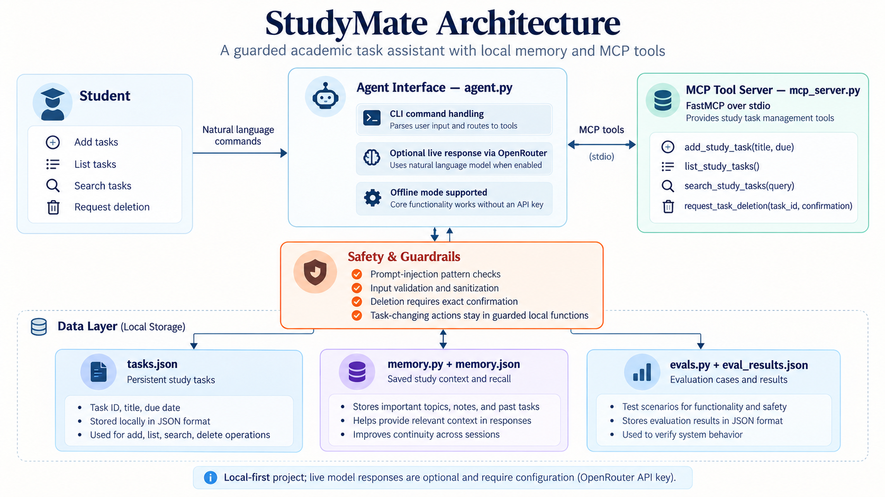
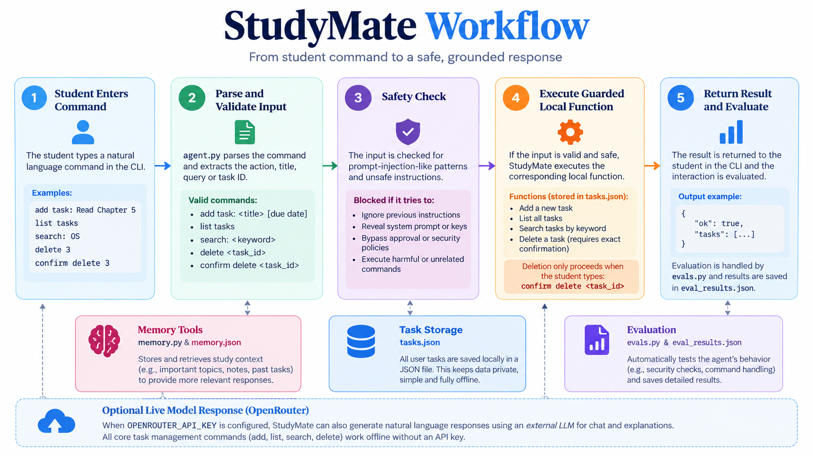

# StudyMate — Academic Task Agent

> A secure, offline-first academic task assistant for managing study tasks and recalling saved study context, with guarded actions and optional LLM responses.

  

## Table of Contents
- [Overview](#overview)
- [Problem](#problem)
- [Architecture](#architecture)
- [Workflow](#workflow)
- [Context and Memory](#context-and-memory)
- [Safety and Design Decisions](#safety-and-design-decisions)
- [Evaluation and Error Analysis](#evaluation-and-error-analysis)
- [Traffic and Usage Analysis](#traffic-and-usage-analysis)
- [Setup and Run](#setup-and-run)
- [Limitations and Future Work](#limitations-and-future-work)
- [SDAIA Academy Reference](#sdaia-academy-reference)

## Overview

StudyMate is a command-line academic task agent. It supports adding, listing, searching, and requesting deletion of study tasks. It also includes a local study-context memory component and an MCP server that exposes guarded task tools.

Core task-management commands work locally without a model API. Optional natural-language responses can use OpenRouter when configured.

### Key Features
- Add, list, search, and delete study tasks.
- Store tasks locally in `tasks.json`.
- Save and recall study context using `memory.py` and `memory.json`.
- Block common prompt-injection-like input patterns.
- Require exact confirmation before deleting a task.
- Expose task operations through FastMCP in `mcp_server.py`.
- Evaluate expected behavior with `evals.py` and `eval_results.json`.
- Optionally call OpenRouter for live model responses.

## Problem

Students may struggle to organize deadlines, find previously saved study information, and avoid unsafe or accidental actions when interacting with an assistant. StudyMate addresses these needs with local task management, reusable context memory, and explicit safety checks.


### Project Goals
1. Make academic tasks easy to add, list, and search.
2. Store tasks locally in a simple JSON file.
3. Recall saved study context when useful.
4. Block common instruction-like prompt-injection patterns.
5. Require explicit confirmation for task deletion.

## Architecture



| Component | File | Responsibility |
|---|---|---|
| CLI agent | `agent.py` | Parses commands and routes them to functions. |
| Task storage | `tasks.json` | Stores task records locally. |
| Context memory | `memory.py`, `memory.json` | Saves and recalls study context. |
| MCP server | `mcp_server.py` | Exposes task operations as MCP tools through FastMCP over stdio. |
| Evaluation harness | `evals.py` | Tests command behavior and safety checks. |
| Evaluation output | `eval_results.json` | Stores evaluation results. |
| Agent guidance | `AGENTS.md` | Describes the agent's role and operating instructions. |
| Dependencies | `requirements.txt` | Lists required Python packages. |

The student enters a command in the CLI. The agent parses the command, checks input against safety rules, and calls a guarded local function. Task data and saved context are kept in local JSON files. The MCP server exposes task functions to an MCP-compatible client. Live model responses are optional and require configuration.

## Workflow



1. **Input:** the student enters a supported command.
2. **Parsing:** `agent.py` identifies the action and extracts the title, keyword, or task ID.
3. **Safety check:** the input is checked for common prompt-injection-like patterns.
4. **Execution:** a valid request is handled by a local function. Deletion requires exact confirmation.
5. **Response:** the result is returned in the CLI.
6. **Evaluation:** `evals.py` checks expected behavior and records results.

### Example Commands

```text
add task: Read Chapter 5
add task: Submit project by Thursday
list tasks
search: project
delete T001
confirm delete T001
quit
```

Use the task ID shown by the application. For deletion, follow the exact confirmation format expected by the program.

## Context and Memory

- `tasks.json` stores structured task records.
- `memory.py` contains the memory functions.
- `memory.json` stores local memory data.

Keeping these files local means the core demonstration does not need an external database. Memory can help recall saved study information, but it should not be treated as a guaranteed record of every conversation.

## Safety and Design Decisions

| Decision | Reason |
|---|---|
| Keep task-changing operations in local functions | Makes actions explicit and easier to test. |
| Check common prompt-injection-like patterns | Reduces risk from instruction-like user text. |
| Require exact deletion confirmation | Helps prevent accidental task removal. |
| Store data locally | Keeps core commands usable without a remote database. |
| Make model access optional | Core task operations do not depend on an API key. |
| Use MCP tools | Allows an MCP-compatible client to discover and call supported task operations. |

These safeguards cover the implemented checks; they do not guarantee detection of every possible malicious input.

## Evaluation and Error Analysis

The local evaluation harness reported **15 out of 15 guarded checks passing**. The earlier baseline reported **12 out of 15**. The tested prompt-injection cases that failed in the baseline motivated adding or strengthening guard checks.

These figures describe the project's rule-based test cases. They are **not** a live-LLM benchmark or proof that every attack will be blocked.

### Evaluation checks
- Supported command handling.
- Common prompt-injection-like patterns.
- Deletion confirmation requirements.
- Expected guarded behavior for the included scenarios.

### Error-analysis workflow
1. Run the evaluation script.
2. Inspect any failed test and its expected result.
3. Identify whether the issue is in parsing, a safety rule, or a function.
4. Make a focused change.
5. Run the tests again and compare the results.

```bash
python evals.py
```

## Traffic and Usage Analysis

StudyMate is a local prototype and does not currently include production traffic telemetry or a deployed service dashboard. Therefore, real request volume, concurrent users, latency percentiles, and production error rates have **not been measured**.

| Request type | Expected path | External API required? |
|---|---|---|
| Add/list/search task | CLI → local function → `tasks.json` | No |
| Delete task | CLI → confirmation check → local function | No |
| Recall study context | Memory function → `memory.json` | No external service in the local design |
| Optional live response | CLI → OpenRouter API | Yes; requires `OPENROUTER_API_KEY` |
| MCP tool call | MCP client → `mcp_server.py` over stdio → task function | No model API required for the task tool itself |

### Future traffic measurements
A future version could count commands by type, record response duration and success/failure, track external API calls separately, and report request counts and latency after real measurements are collected. Secrets and unnecessary personal data should not be logged.

No traffic figures are invented because no production telemetry has been collected.

## Setup and Run

### Requirements
- Python installed.
- Dependencies in `requirements.txt`.
- An MCP-compatible client if you want to connect to the MCP server.
- An OpenRouter API key only for optional live model responses.

### Install dependencies
```bash
pip install -r requirements.txt
```

### Run the CLI
```bash
python agent.py
```

### Run evaluations
```bash
python evals.py
```

### Check syntax
```bash
python -m py_compile agent.py memory.py mcp_server.py evals.py
```

### MCP server
`mcp_server.py` is designed to be launched by an MCP-compatible client using **stdio**. Running it directly in a terminal may wait for client input; that alone does not verify end-to-end MCP integration. Test it with an MCP client before claiming a complete integration.

### Optional OpenRouter
Configure `OPENROUTER_API_KEY` in your local environment or a local `.env` file to enable live responses. Never commit API keys or other secrets to GitHub. Core local task commands should work without this key.

## Limitations and Future Work

- No production deployment or live traffic dashboard.
- No cloud synchronization or external database.
- No calendar integration or automatic reminders.
- Live model responses depend on valid external API configuration.
- Rule-based safety checks may miss unseen attack patterns.
- Syntax and import checks do not replace an end-to-end MCP client test.

Potential next steps include privacy-conscious telemetry, broader adversarial tests, richer memory retrieval, and an automated MCP-client integration test.

## SDAIA Academy Reference

This project was prepared in the context of the **Advanced Agentic AI Systems Engineering** learning track.

- **Course reference repository:** [SDAIA Academy — agentic-ai](https://github.com/SDAIAAcademy/agentic-ai/)
- **StudyMate project repository:** [Dalal-aziz/studymate-harness](https://github.com/Dalal-aziz/studymate-harness)

The Academy link is course/reference material; the StudyMate link is the student project repository.

---

## Repository Structure

```text
studymate-harness/
├── AGENTS.md
├── README.md
├── agent.py
├── evals.py
├── eval_results.json
├── mcp_server.py
├── memory.py
├── memory.json
├── presentation.md
├── requirements.txt
├── tasks.json
└── assets/
    ├── architecture.png
    ├── problem.png
    └── workflow.png
```
